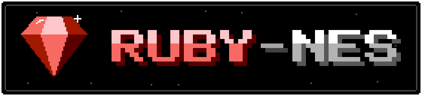

<h1 align="center"></h1>

<p align="center">
  <a href="../../actions/workflows/ci.yml"></a>
  <a href="../../actions/workflows/ci.yml"></a>
  
  
</p>

A Nintendo Entertainment System emulator written in pure Ruby: no C extension in the emulation, only Ruby code, from
the 6502 CPU to the picture and the sound. It plays Super Mario Bros. 3 at full speed, with sound, in a window.

It is a study project. It explores two things at once: how the NES works, and how far modern Ruby can go on one of the
tightest loops there is.

## Contents

- [The question](#the-question)
- [What is emulated](#what-is-emulated)
- [Installation](#installation)
- [Playing](#playing)
- [Running without a window](#running-without-a-window)
- [Development](#development)
- [Documentation](#documentation)
- [Legal](#legal)

## The question

**Can an emulator written in Ruby run NES games at full speed?**

An emulator is about the worst workload you can hand an interpreter. The NES's CPU runs about 1.79 million cycles a
second, and its picture processor draws three dots per CPU cycle: 89,342 dots and 29,780 CPU cycles per frame, sixty
times a second. Each of those steps is a handful of integer operations, table lookups and branches, with no I/O to hide
behind and no library doing the heavy lifting in C. Every cycle has to happen in Ruby, millions of times a second.

Not long ago the honest answer was "no". Ruby got here through a series of changes:

- **The interpreter.** Ruby 1.9 (2007) replaced the tree-walking interpreter with YARV, a bytecode virtual machine,
  which is still the interpreter today. Ruby 3.0's "Ruby 3x3" goal was a Ruby three times as fast as Ruby 2.0.
- **YJIT.** Developed at Shopify, it arrived in Ruby 3.1 (2021) as an experimental just-in-time compiler. It was
  rewritten in Rust and became production-ready in Ruby 3.2 (2022). It compiles basic blocks lazily, specialising them
  for the types it actually sees, which suits an emulator's integer loops well.
- **ZJIT.** The same team's next-generation, method-based JIT, shipped in Ruby 4.0 (December 2025) as an experiment.
  It is faster than the interpreter but not yet as fast as YJIT, and its authors aim to make it production-ready and
  faster than YJIT in Ruby 4.1.
- **Spinel.** Matz's ahead-of-time compiler: it infers the types of a whole Ruby program and turns it into C, then
  into a native executable.

This project was built to put those numbers on a real workload. Every frame of Super Mario Bros. 3 is measured the
same way: world 1-1 with sound, a scripted controller, 1200 warm-up frames, then 5 runs of 60 frames. The frame and
audio digests prove that every optimisation left the emulation exactly as it was. Measured on a 2019 Intel laptop
(Core i5-8257U, 1.4 GHz); the NES draws 60.1 frames per second:

| Step | Interpreter | YJIT | ZJIT |
|---|---:|---:|---:|
| Everything emulated, picture and sound (plans 00-24) | 4.3 | 14.2 | 12.7 |
| Performance pass: inline flag tests, the renderer as a pipeline (plan 25) | 5.2 | 23.4 | 15.4 |
| Ranges of dots instead of dot by dot (plan 28) | 7.0 | 27.9 | 19.4 |
| The APU synced at deadlines, in runs of cycles (plan 29) | 10.2 | 34.1 | 30.3 |
| The background, a tile at a time (plan 30) | 14.5 | 46.6 | 39.5 |
| Sprites and the horizontal blank (plan 31) | 17.2 | **61.5** | 44.5 |
| The palette lookup moved to the GPU (plan 32) | 17.8 | 64.7 | 46.6 |
| Triangle and noise clocked exactly within runs (plan 33) | 18.5 | **66.8** | 48.4 |

Frames per second, emulation only; the window keeps the game at the NES's 60.1.

What that shows:

- **YJIT made it possible.** It runs the emulation about 3.6 times as fast as the interpreter, and it crossed 60
  frames per second in plan 31. The window plays the game at full speed with crackle-free sound.
- **ZJIT is a strong second.** On the CPU alone it started out slower than the interpreter. It now runs the whole
  emulator at 48 frames per second, and it is the likely successor once it matures.
- **The interpreter got 4 times faster too,** from the same changes. They were algorithmic, not JIT tricks, and kept
  the emulation exact: the digests never changed.
- **Spinel goes further, without a window.** It compiled the emulation core unchanged and runs it at 95 frames per
  second, 179 with a few type signatures and wrapping integers (2.75 times YJIT). The window doesn't compile yet,
  because of bugs in Spinel itself, so YJIT remains the way to play. See [`docs/spinel.md`](docs/spinel.md).

Every measurement, with the profiles that led to each change, is in [`docs/benchmarks.md`](docs/benchmarks.md).

## What is emulated

- **CPU:** the Ricoh 2A03's 6502 core, with every official and unofficial opcode, cycle by cycle, including the
  dummy reads and the interrupt timing. It matches nestest's log line by line.
- **PPU:** registers, VRAM and mirroring, background and sprites, sprite 0 hit and overflow, VBlank and NMI timing.
- **APU:** two pulse channels, triangle, noise and DMC, the frame counter and the mixer, played at 48 kHz.
- **Mappers:** NROM (0), MMC1 (1), UxROM (2), CNROM (3), MMC3 (4) with its scanline IRQ, and AxROM (7). iNES files.
- **Controllers:** both controllers, from the keyboard and USB gamepads, with configurable keys and buttons.
- **Frontends:** a window with sound (raylib) and a ROM browser in it, save states, and a headless mode that writes
  screenshots and WAV audio.

Not emulated (yet): PAL consoles, and other mappers. The test ROMs the suite runs are listed in
[`docs/test-roms.md`](docs/test-roms.md).

## Installation

Tested on macOS (Intel). Linux should work too: the raylib library ships prebuilt for both, and CI runs the test suite
on Ubuntu.

### 1. A Rust compiler, so Ruby is built with its JITs

Ruby builds YJIT and ZJIT only if a Rust compiler is installed **when Ruby itself is compiled**. ZJIT needs Rust 1.85
or newer. Without one, Ruby still builds and runs, but without its JITs, and the emulator falls to a third of its
speed. Install Rust before Ruby:

```bash
brew install rust                                                # macOS, with Homebrew
curl --proto '=https' --tlsv1.2 -sSf https://sh.rustup.rs | sh  # or anywhere, with rustup
rustc --version                                                  # 1.85 or newer
```

### 2. Ruby 4.0.10

The version is pinned in `mise.toml`. With [mise](https://mise.jdx.dev):

```bash
mise install    # builds Ruby 4.0.10
```

Any other Ruby version manager works too, as long as it builds 4.0.10. Then check that the JITs are there:

```bash
ruby --yjit -v   # the description must include +YJIT
ruby --zjit -v   # and this one +ZJIT
```

If a JIT is missing, Ruby was built before Rust was installed: install Rust, then build Ruby again
(`mise uninstall ruby@4.0.10 && mise install`).

### 3. The gems, including the window's

```bash
git clone https://github.com/bvicenzo/ruby-nes.git
cd ruby-nes
bundle config set --local with frontends   # the window's gem lives in an optional group
bundle install
```

The window's gem, raylib-bindings, is in an **optional** Gemfile group named `frontends`. The emulation core never
needs it, and the test suite runs without it. A plain `bundle install` skips it, and the emulator then stops with a
message asking for this group. `bundle config set --local with frontends` writes the choice into `.bundle/config`, so
every later `bundle install` in this checkout installs it.

raylib-bindings ships the raylib library prebuilt for macOS (Intel and Apple Silicon), Linux (x86-64 and ARM64) and
Windows, so there is nothing to compile.

- **Graphics:** the picture goes through an OpenGL 3.3 shader.
- **Linux:** the window needs a desktop session with X11 or XWayland, OpenGL drivers (Mesa or your GPU's), and ALSA
  or PulseAudio for the sound. A desktop install has them all. A minimal one may lack the X11 libraries (libX11,
  libXrandr, libXinerama, libXcursor, libXi), libGL or libasound. With PulseAudio or PipeWire the emulator asks for
  15 ms of audio latency (`PULSE_LATENCY_MSEC=15`), so the sound keeps the window at 60 fps; a value you export
  yourself is kept, and from 25 ms the window slows down.

### 4. A ROM

ROM images are copyrighted and not distributed with this project: use dumps of cartridges you own. Put them under
`roms/`, which git ignores. Some benchmarks and specs look for `roms/smb3.nes`. Without it they are skipped, or say
where to put it.

## Playing

```bash
bundle exec exe/ruby-nes roms/smb3.nes
```

The window opens at 3× scale and runs under YJIT, with sound.

| Option | Default | What it does |
|---|---|---|
| `--jit none\|yjit\|zjit` | `yjit` | The JIT the emulator runs under, enabled at startup. |
| `--scale N` | `3` | Window scale. |
| `--aspect square\|8:7` | `square` | Square pixels, or the 8:7 pixel aspect of a TV. |
| `--crop-overscan` | off | Shows lines 8 to 231 only, as TVs did. |
| `--config PATH` | `~/.config/ruby-nes/config.yml` | The keys and gamepad configuration file. |
| `--no-audio` | off | No sound; the timer paces the frames. |

`bundle exec exe/ruby-nes --help` lists every option.

### The ROM browser

```bash
bundle exec exe/ruby-nes            # the ROMs of roms/
bundle exec exe/ruby-nes ~/games    # the ROMs of a folder
```

Without a ROM, the window opens on a list of the `.nes` files of a folder: the one named on the command line, else the
one `roms_directory:` names in the config file, else `roms/` under the current directory.

```yaml
roms_directory: ~/games/nes
```

- **Moving.** Up and down move through the list, left and right a page at a time, from the keyboard or the first
  gamepad. A or Start starts the game. Escape, or L + R on the gamepad, opens the list's menu: RESUME or QUIT.
- **Back to the list.** BACK TO LIST in a game's pause menu goes back to it, writing the game's battery save first.
- **Names and marks.** A game shows under its file name, without the tags in brackets, such as `(USA)`, which show
  under the preview. ♥ marks a game with a battery save, ★ one with save states. A ROM ruby-nes cannot run, such as
  one with a mapper it does not support, is listed in grey with the reason in the preview's place, and does not
  start.
- **Previews.** Rest on a game for half a second and it plays itself in the preview, as it would on a TV left alone:
  its title screen, then the demo. The first time, the preview waits for the picture to start moving (a few seconds
  for most games, about 20 for some), and keeps that moment as a save state in
  `~/.local/share/ruby-nes/previews/`, named after the ROM's SHA-256. From then on that moment shows at once, and the
  demo goes on from there. The preview is silent and never touches the game's saves.

### The pause menu

Escape in a game, or L and R held together on the gamepad, pauses it under a menu, its picture dimmed:

- **RESUME** goes back to the game, as B, Escape or L + R again do.
- **SAVE STATE** and **LOAD STATE** open the ten save state slots, each with the picture of its moment; ★ marks a slot
  that holds a state. Up and down pick one, A or Start save or load there, and it becomes the current slot (see Save
  states). B goes back to the menu.
- **RESET** presses the console's reset button.
- **BACK TO LIST** returns to the ROM browser, in a game started from it.
- **QUIT** closes ruby-nes, writing the game's battery save first.

The menu is moved with the D-pad or the arrow keys, from the keyboard or the first gamepad, so a game can be left,
and ruby-nes closed, from the pad alone. Buttons still held as the menu closes reach the game only once let go. P still
pauses without a menu.

### Keys

| NES controller | Key | | Emulator | Key |
|---|---|---|---|---|
| A | X | | Pause | P |
| B | Z | | Reset | R |
| Select | Right Shift | | Frame rate overlay | F |
| Start | Enter | | Menu (pause menu in a game) | Escape |
| D-pad | Arrow keys | | Save state | F5 |
| | | | Load state | F7 |
| | | | Previous / next state slot | F6 / F8 |
| | | | Quit at once | none |

Keys are set in `~/.config/ruby-nes/config.yml`, or in the file given with `--config`. Each action takes a key name or
a list of them, and `[]` leaves an action without a key. Actions the file doesn't mention keep their default keys:

```yaml
keys:
  a: x
  b: [z, left_control]
  pause: space
```

Quitting is in the menu, so `quit` has no key unless the file gives it one; `quit: escape` brings back Escape as it was
before the menu (in a game started from the list it returns to the list, elsewhere it quits), and leaves the menu to
L + R on the gamepad.

### Gamepads

A USB gamepad plays too: the first one is player 1, beside the keyboard, and a second one is player 2. They can be
plugged in or pulled out while the game runs. Players follow the order raylib numbers the pads in: with two pads in,
pulling out the first leaves the second as player 2. The buttons are named by their place on a standard pad, as raylib names
them, so on a SNES-style pad the letters match:

| NES controller | Gamepad button | SNES-style pad |
|---|---|---|
| A | `right_face_right`, `right_face_up` | A, X |
| B | `right_face_down`, `right_face_left` | B, Y |
| Select | `middle_left` | Select |
| Start | `middle_right` | Start |
| D-pad | `left_face_up`, `left_face_down`, `left_face_left`, `left_face_right` | D-pad |

The left analog stick, on pads that have one, moves too once pushed past half way. The other buttons are
`left_trigger_1`, `right_trigger_1` (L and R), `left_trigger_2`, `right_trigger_2`, `middle`, `left_thumb` and
`right_thumb`. The `gamepad:` section of the config file sets them with the rules of `keys:`. Emulator hotkeys stay on
the keyboard, except the menus: L and R held together open them (see The pause menu).

```yaml
gamepad:
  a: right_face_down
  b: right_face_left
```

raylib recognises a pad from the SDL GameControllerDB mappings it carries, which tell it where each physical button
is. A pad it does not know answers to nothing; one that matches the wrong mapping shows buttons that answer as other
buttons, or Select and Start that move the D-pad. Give it its own line from
[SDL_GameControllerDB](https://github.com/mdqinc/SDL_GameControllerDB) (or one written for it by a tool such as SDL's
`controllermap`), under `gamepad_mappings:`. raylib skips a line it cannot read without saying so, so test the pad
after adding one:

```yaml
gamepad_mappings: |
  03000000790000001100000010010000,Retrolink SNES Controller,a:b2,b:b1,back:b8,dpdown:+a1,dpleft:-a0,dpright:+a0,dpup:-a1,leftshoulder:b4,rightshoulder:b5,start:b9,x:b3,y:b0,platform:Linux,
```

On Linux, raylib reads the pad from `/dev/input`, which desktop sessions open to the logged-in user. A cheap USB SNES
pad (DragonRise chip, `0079:0011`) is known to raylib on Linux and macOS as it is.

### The screensaver

Most systems count only the keyboard and the mouse as activity, so a game played on a gamepad alone can be taken over
by the screensaver or the lock screen after a few minutes. ruby-nes does not yet ask the system to stay awake, and a
compositor that listens only to Wayland's idle-inhibit protocol could not hear it anyway: raylib's window is an X11 one,
run through XWayland. Until then, the desktop can be told to keep the screen awake while the emulator's window is
focused. On Hyprland (Omarchy included), whose Lua config matches the window by its class, `ruby-nes`:

```lua
-- Omarchy, in ~/.config/hypr/hyprland.lua:
o.window("ruby-nes", { idle_inhibit = "focus" })
-- Hyprland without Omarchy's helpers:
hl.window_rule({ match = { class = "ruby-nes" }, idle_inhibit = "focus" })
```

`focus` keeps the screen awake while the window has focus: a game paused and left focused keeps it awake too, but the
screen sleeps again once another window takes the focus. `always` keeps it awake as long as the window is open.
`fullscreen`, the rule Omarchy gives other emulators, never applies here, as the window has no fullscreen mode.

A future version could ask the system itself, the way SDL games do: `SetThreadExecutionState` on Windows,
`IOPMAssertionCreateWithName` on macOS, and `org.freedesktop.ScreenSaver.Inhibit` over D-Bus (or the desktop portal's
Inhibit) on Linux. Desktops that listen only to the Wayland protocol would still need the rule above while the window
is X11.

### Saves

Games that keep their progress on the cartridge's battery (The Legend of Zelda, Final Fantasy, Kirby's Adventure…)
keep it here too. The window loads the game's save when it starts, writes it every few seconds while the game changes
it, and once more when the window closes. Saves live in `~/.local/share/ruby-nes/saves/` (or
`$XDG_DATA_HOME/ruby-nes/saves/`), named after the ROM file: `Legend of Zelda, The (USA) (Rev 1).nes` saves to
`Legend of Zelda, The (USA) (Rev 1).sav`. They are the raw 8 KiB of the cartridge's RAM, as other emulators keep
theirs, so a `.sav` copied from one of them, renamed after the ROM, just works. A game without a battery saves
nothing, and `--headless` never reads or writes saves.

### Save states

A save state keeps the whole machine at one moment, so any game can be left and taken up again exactly there, even
one with no save of its own:

- **Save and load.** F5 saves to the current slot, replacing what was there, and F7 loads it; the pause menu does both
  on the slot picked by its picture. The sound starts over from that moment.
- **Slots.** There are 10 slots, 0 to 9, picked with F6 and F8, and a game opens on the slot it saved last. A message
  at the bottom of the window says what happened: "State 3 saved", "Slot 4", "State 3 is empty".
- **Files.** A state lives in `~/.local/share/ruby-nes/states/<ROM name>/` (or under `$XDG_DATA_HOME`), as
  `<slot>.state` with a picture of the moment, `<slot>.png`. A state is about 10-20 KB: the game itself is not inside.
- **The game's own save.** A state also holds the cartridge's battery RAM, so after loading one the battery save
  follows it, as in other emulators.
- **Refused states.** A state saved from another ROM, or by a version of ruby-nes whose machine is built differently,
  is refused with a message, and the game goes on. So is a state saved with `--no-audio` loaded with the sound on, or
  the other way round.

A state is written with Ruby's Marshal, which can build any object when it is loaded: **load only states ruby-nes
saved on your own machine**, never ones from someone else.

## Running without a window

`--headless` runs the emulator with no window and no sound device, as fast as it can. It is how the specs and the
benchmarks drive it, and it makes repeatable captures:

```bash
bundle exec exe/ruby-nes roms/smb3.nes --headless --frames 600 \
  --input spec/fixtures/smb3_world_1_1.yml \
  --screenshot 300:tmp/title.png --screenshot 600:tmp/world.png \
  --wav tmp/audio.wav
```

| Option | What it does |
|---|---|
| `--frames COUNT` | Frames to run. |
| `--screenshot FRAME:PATH` | Writes that frame as a PNG image. It can be given more than once. |
| `--input SCRIPT` | A YAML script of the buttons held on the first controller, by frame number. |
| `--wav PATH` | Writes the audio as a WAV file. |

An input script maps frame numbers to the buttons held from that frame on; `[]` releases them all:

```yaml
60: [start]    # Start during frame 60 only
61: []
120: [a, right]  # A and Right from frame 120 on
```

## Development

```bash
bundle exec rake                    # tests and lint, as CI runs them
bundle exec rspec                   # tests
COVERAGE=1 bundle exec rspec        # tests with branch coverage (report in coverage/)
bundle exec rubocop                 # lint
```

### Test ROMs

The suite checks the emulator against the community's test ROMs (nestest, blargg's suites), downloaded from a pinned
commit and verified by checksum. Without them, their specs are skipped:

```bash
bundle exec rake test_roms:fetch            # into spec/fixtures/test_roms, which git ignores
bundle exec rake nestest:diff               # the first line where the CPU leaves nestest's log, if any
bundle exec rake 'blargg:run[<rom path>]'   # one blargg ROM's result
```

blargg's ROMs run for seconds each, so they are tagged `slow` and skipped unless `SLOW=1`. Run them under YJIT, as
CI does: with it, the suite takes about 10 minutes, and without a JIT, over an hour.

```bash
SLOW=1 RUBYOPT=--yjit bundle exec rake
```

### Benchmarks

Each task appends a dated table to [`docs/benchmarks.md`](docs/benchmarks.md):

```bash
bundle exec rake bench:cpu       # the CPU alone on nestest, under no JIT, YJIT and ZJIT
bundle exec rake bench:frames    # Super Mario Bros. 3 (roms/smb3.nes), under no JIT, YJIT and ZJIT
bundle exec rake bench:profile   # where the time goes, sampled with vernier under YJIT
bundle exec rake spinel:fetch    # downloads and builds Spinel into tmp/spinel (about 2 minutes)
bundle exec rake bench:spinel    # nestest and Super Mario Bros. 3 on CRuby and compiled by Spinel
```

### How it is built

- **Planned.** The work follows the plans in [`plans/`](plans/README.md), from an empty gem to Super Mario Bros. 3
  with sound, then the performance experiments. Each plan has its goal, decisions, tasks and acceptance criteria.
- **Test-first.** Every unit is specified before it is written, one example per cause. Hardware behaviour asserted
  in a spec is backed by the [NESdev Wiki](https://www.nesdev.org/wiki/Nesdev_Wiki), never by memory.
- **Readable.** No abbreviations beyond the hardware's own names, which are explained in the glossary. Bit operations
  are named, and the hot paths follow rules of their own.

## Documentation

| Document | What is in it |
|---|---|
| [`docs/architecture.md`](docs/architecture.md) | Components, buses, the clock model, hot paths, conventions, and the decisions log. |
| [`docs/benchmarks.md`](docs/benchmarks.md) | Every measurement, with the findings behind each optimisation. |
| [`docs/spinel.md`](docs/spinel.md) | The ahead-of-time compilation experiment with Spinel. |
| [`docs/backend-comparison.md`](docs/backend-comparison.md) | Why the window uses raylib rather than SDL3. |
| [`docs/test-roms.md`](docs/test-roms.md) | The test ROMs the suite runs, and how each reports. |
| [`docs/GLOSSARY.md`](docs/GLOSSARY.md) | Hardware acronyms and bit-operation names. |
| [`plans/`](plans/README.md) | The roadmap, plan by plan, and the backlog. |

## Legal

ruby-nes is not affiliated with, endorsed or sponsored by Nintendo. "Nintendo Entertainment System", "NES" and the
games mentioned here are trademarks of their owners. No ROM image is distributed with this project.

GPL-3.0-or-later. See [LICENSE](LICENSE).
